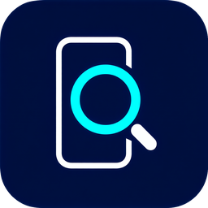

<p align="center"></p>

# emu-glass

A low-latency alternative to scrcpy for the **local Android Emulator**.

scrcpy encodes the screen to video inside the emulated device, using the guest's software
encoder. emu-glass instead reads frames straight from the emulator's GPU output over gRPC and
shared memory: full resolution, no compression artifacts, about 33 ms from touch to pixel (measured).

It only works with the Android Emulator on the same machine. For real devices or remote machines,
use scrcpy.

## Run

```
emulator -avd MyAvd -no-window -gpu host -grpc 8554
pip install grpcio protobuf pygame-ce numpy opencv-python
python emuglass.py --emu MyAvd            # or --emu emulator-5554, or --port 8554
```

Options: `--pane left|right`, `--frame-fps 30|60`, `--sharpen 0..1`, `--view-only`, `--debug`.

## Controls

Left click/drag: touch. Wheel: swipe. Right click, Esc: Back. Middle click: Home.
Android Emulator shortcuts: Ctrl+H, Ctrl+Backspace, Ctrl+O, Ctrl+M, Ctrl+P, Ctrl+=/-, Ctrl+Left/Right, Ctrl+S.
Ctrl+F: fullscreen. F1: overlay with help.

`emu_grpc/` is generated from the emulator's `emulator_controller.proto` (Android SDK, Apache 2.0).
